  

  
  
  
  
  

 

## Model card

| | |
|:--|:--|
| **Model** | `muneeb-ul-hassan` · v7.0 |
| **Task** | Turning messy, real-world data into machine learning systems that actually ship |
| **Training data** | 7 years of production data science, currently in real-estate tech in Paris |
| **Pre-training** | MSc Computer Science (Australia) · M2 from a French Grande École |
| **Strengths** | Predictive modelling · ML pipelines & MLOps · LLM-powered applications · full-stack prototyping |
| **Fine-tuned on** | Indie making: taking small AI products from model to landing page, solo |
| **Known limitations** | Cannot resist plotting the residuals |
| **Intended use** | Collaboration on ML, data and AI product work. See contact links above |

 

## Selected work

<table>
  <tr>
    <td width="50%" valign="top">
      <h3><a href="https://www.plabster.com">Plabster</a></h3>
      
A preparation platform for the PLAB 2 clinical exam, helping international medical graduates practise for UK licensing.

      
<a href="https://www.plabster.com"><b>Live site →</b></a>

    </td>
    <td width="50%" valign="top">
      <h3><a href="https://imagi-kids.vercel.app/">Imagi Kids</a></h3>
      
AI-generated, illustrated stories for children: a small product exploring safe, delightful generative content.

      
<a href="https://imagi-kids.vercel.app/"><b>Live site →</b></a>

    </td>
  </tr>
</table>

 

## Toolkit

| Domain | Stack |
|:--|:--|
| **ML & AI** |  |
| **Data & Backend** |  |
| **Product & Frontend** |  |
| **Cloud & Ops** |  |

 

## Certifications

  
  
  

 

  
<b>GitHub activity</b>

   
  

    
    
  

  

    
  

 

<picture>
  <source media="(prefers-color-scheme: dark)" srcset="https://raw.githubusercontent.com/muneebable/muneebable/output/github-contribution-grid-snake-dark.svg" />
  <source media="(prefers-color-scheme: light)" srcset="https://raw.githubusercontent.com/muneebable/muneebable/output/github-contribution-grid-snake.svg" />
  
</picture>

Currently exploring open-source LLMs, ML automation and small, useful AI products.

